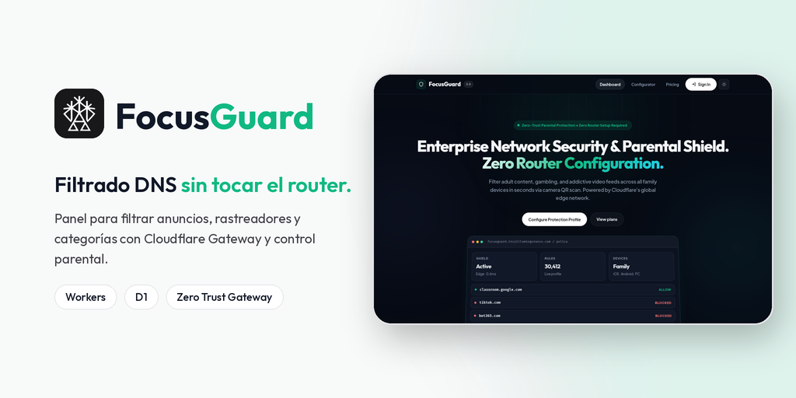
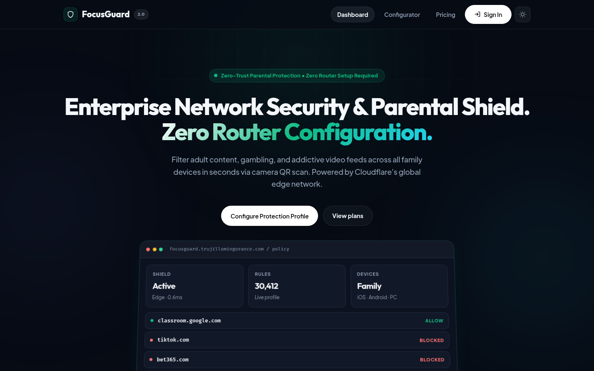
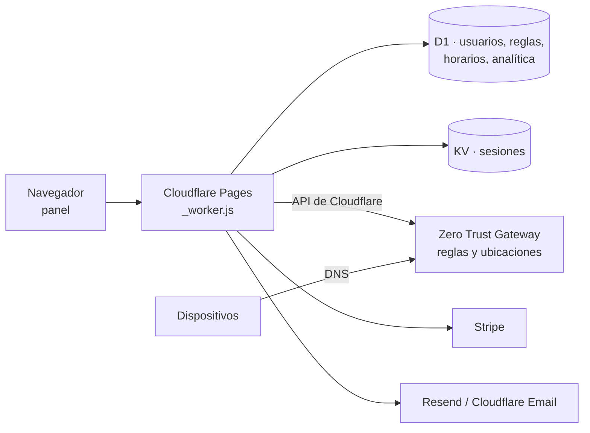

<p align="center">
  
</p>

<p align="center">
  <strong>Panel para filtrar anuncios, rastreadores y categorías de contenido por DNS, con control parental y listas para Pi-hole, sobre Cloudflare Zero Trust Gateway.</strong><br/>
  <em>DNS filtering dashboard (ads, trackers, parental controls) built on Cloudflare Zero Trust Gateway, with Pi-hole and dnsmasq exports.</em>
</p>

<p align="center">
  <a href="https://focusguard.trujillomingorance.com"><b>focusguard.trujillomingorance.com</b></a> ·
  <a href="SECURITY.md">Seguridad</a>
</p>

<p align="center">
  
  
  
  
</p>

---

## Capturas

<p align="center"></p>

## Funciones

- **Filtrado DNS** con reglas de Cloudflare Zero Trust Gateway: anuncios, rastreadores, malware y categorías (adultos, apuestas, redes sociales, juegos, vídeo).
- **AdShield:** perfiles de bloqueo de anuncios y listas por paquetes.
- **Control parental** con interruptor rápido y **horarios** por perfil.
- **Exportar listas** para otros bloqueadores: `rules.json`, lista de Pi-hole y `dnsmasq.conf`.
- **Configuración guiada** de dispositivos, con códigos QR y página para Android.
- **Panel** con contadores de consultas y dominios bloqueados, diagnóstico y ajustes.
- **Cuentas** con Google, X o correo (verificación y recuperación por email).
- **Suscripción** preparada con Stripe Checkout, portal de cliente y webhook.

## Stack

| Capa | Tecnología |
|---|---|
| Frontend | TypeScript + Vite (SPA sin framework) y service worker |
| Hosting | **Cloudflare Pages** en modo avanzado (`dist/_worker.js`) |
| Backend | Worker en TypeScript (`worker/src/`), empaquetado con esbuild |
| Datos | **Cloudflare D1** (`focusguard_db`) y **Workers KV** (`SESSIONS_KV`) |
| DNS | **Cloudflare Zero Trust Gateway** (reglas y ubicaciones por API) |
| Pagos | Stripe |
| Email | Resend y Cloudflare Email |

## Arquitectura



## Seguridad

- **Sesiones** con JWT verificados en el servidor y guardados en KV.
- **Token de Cloudflare** solo en el servidor, para gestionar las reglas de Gateway.
- **Webhook de Stripe** con firma verificada.
- Detalles y contacto en [SECURITY.md](SECURITY.md).

## Desarrollo local

Requisitos: **Node.js ≥ 20**.

```bash
git clone https://github.com/ATM-Software-Labs/focusguard-saas.git && cd focusguard-saas
npm install
npm run dev            # Vite en http://localhost:5173 (API en :8787)
npm run build          # tsc + Vite + _worker.js
```

Esquema de base de datos: `schema.sql` (usuarios, tenants, reglas, horarios y analítica).

## Despliegue

El proyecto de Cloudflare Pages `focusguard` está conectado a GitHub: cada push a `main` compila y publica en `focusguard.trujillomingorance.com`. También se puede publicar con `npm run deploy`.

### Variables y bindings (solo nombres)

| Nombre | Tipo | Uso |
|---|---|---|
| `DB` | binding D1 | Base de datos `focusguard_db` |
| `SESSIONS_KV` | binding KV | Sesiones |
| `JWT_SECRET` | secreto | Firma de sesión |
| `CLOUDFLARE_ACCOUNT_ID`, `CLOUDFLARE_API_TOKEN` | variable / secreto | Gestión de Zero Trust Gateway |
| `X_CLIENT_ID`, `X_CLIENT_SECRET` | variable / secreto | Acceso con X |
| `STRIPE_SECRET_KEY`, `STRIPE_WEBHOOK_SECRET` | secretos | Pagos |
| `RESEND_API_KEY` | secreto | Correos de cuenta |
| `GROQ_API_KEY`, `TRUJILLO_AI_API_KEY` | secretos, opcionales | Clasificación de dominios con IA |

## Estructura

```
src/core/          configuración, i18n y utilidades
src/features/      adshield, auth, dashboard, diagnostics, generator, pihole, settings, stripe
worker/src/        backend (rutas /api/*, listas, Gateway, Stripe)
public/            _headers, manifest, service worker, iconos
schema.sql         esquema de D1
docs/              banner y capturas
```

## Licencia

Todos los derechos reservados © 2026 Alberto Trujillo Mingorance.

<p align="center"><sub>© 2026 ATM Software Labs · <a href="https://trujillomingorance.com">trujillomingorance.com</a></sub></p>
